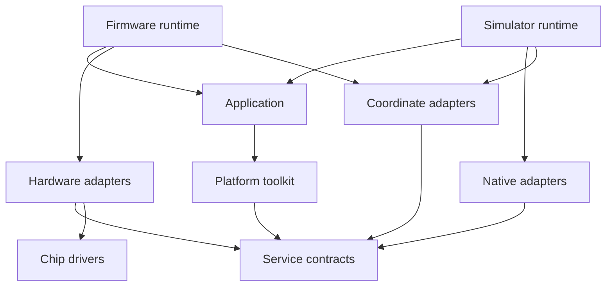

# Software architecture

The project has an application, a platform toolkit, and backend implementations.
The platform contains common functionality for application development.
Applications combine toolkit components into their screens and workflows.
The toolkit has no dependency on a particular application.

## Boundaries

| Code | Responsibility | Project dependencies |
| --- | --- | --- |
| [`crates/app`](../crates/app/src/lib.rs) | Application state, screens, layout, actions, and policy choices | `paper-mesh-platform` |
| [`crates/platform`](../crates/platform/src/lib.rs) | Application toolkit and portable contracts | None |
| [`crates/pcf8563`](../crates/pcf8563/src/lib.rs) | PCF8563 calendar access through I2C | Platform calendar contract |
| [`firmware/src/main.rs`](../firmware/src/main.rs) | Hardware startup and connection of the application to services | Application, platform, and hardware adapters |
| [`firmware/src`](../firmware/src/main.rs) adapters | Hardware services, drivers, buffers, and resource control | Platform and chip drivers |
| [`simulator/src/lib.rs`](../simulator/src/lib.rs) | Native services and deterministic application execution | Application and platform |
| [`simulator/src/main.rs`](../simulator/src/main.rs) | HTTP transport and wall-clock pacing | Simulator and platform |
| [`crates/hid-touchpad`](../crates/hid-touchpad/README.md) | Host HID descriptors and contact encoding | Platform |
| [`crates/ed047tc1`](../crates/ed047tc1/src/lib.rs), [`crates/gt911`](../crates/gt911/src/lib.rs) | Chip protocols and display encoding | None |

Both shared crates use `no_std` without heap allocation.
The root workspace also builds the simulator and tests the chip and host protocols.
Firmware stays outside that workspace to isolate Xtensa settings and ESP dependency features.
Its manifest uses path dependencies for the application, platform, and adapter crates.

The platform owns calendar synchronization through its `Rtc` contract.
The PCF8563 crate implements that contract without ESP peripherals or executor dependencies.
The platform has no dependency on the PCF8563 crate.
Firmware retains the RTC worker, shared bus ownership, scheduling, and suspend coordination.
The platform supplies a [worker pause channel](platform/worker-coordination.md) with separate controller and worker endpoints.
The runtime creates the channel and passes its endpoints to the RTC clock handle and task.
The clock control handle implements the platform [suspend participant contract](services/power.md#suspend-participants).
The runtime supplies that handle to the suspend controller through the generic contract.
The handle also implements the independent [power-off participant contract](services/power.md#power-off-participants).
The runtime supplies this capability separately to the power-off coordinator.
Power-off faults use watchdog reset and the normal startup checks before workers restart.
The RTC no longer registers with the global firmware pause registry. Other workers retain that mechanism until their migration.
The worker reads shared synchronization state after each pause so lifecycle invalidation reaches its next poll.
It supplies observation age limits, correction thresholds, and calendar range to the synchronization service.
Startup supplies location observations through a callback, so the RTC worker does not depend on the GNSS adapter.

The platform defines the [reply transport contract](services/connectivity.md#reply-transport).
USB owns transport state and implements acknowledged replies. The runtime supplies command dispatch.
ROM download and display inspection handlers depend on the platform contract instead of the USB module.
USB hardware, session tracking, and lifecycle coordination remain in firmware.

Arrows show code dependencies.
`paper-mesh-platform` does not depend on `paper-mesh-app`.
Backend adapters import service types directly from `paper-mesh-platform`.
Runtime code connects the application to backend services.
The application crate does not export the platform API.

The Diagnostics menu, component pages, pattern sequence, and input policy belong to the application crate.
The runtime supplies control identities and display completion events.
USB inspection reads a held frame without starting a display operation.
The display backend retains power sequencing and resource ownership.
The [display profile](boards/lilygo-t5-s3-pro-display.md#basic-display-check) defines the hardware procedure and its limits.

The [clock contract](services/time.md) separates monotonic deadlines from optional UTC calendar time.
The RTC backend consumes complete GNSS observations and controls persistent calendar access.
The platform supplies calendar types and elapsed-time conversion without hardware dependencies.

The [power contract](services/power.md) separates battery observations from charger observations.
Backends control device access and measurement conversion. The application controls the detail screen and observation age limits.
The application also requests explicit lifecycle transitions through portable request and error types.
The runtime coordinates display completion and service preparation before the backend changes system power.
Hardware recovery deadlines and retained fault records stay in the firmware backend.

Common functionality belongs in the platform crate.
Toolkit components accept application choices through parameters and callbacks.
Modules group related functions by responsibility.
The current application is one toolkit consumer.
Future applications can use the same components without a dependency on its screens.

[Composition](platform/composition.md) owns a shared layer hierarchy with scoped roots and atomic updates.
The [UI](platform/ui.md) system supplies elements, layout, and callbacks. Layout writes explicit geometry into layers.
The calculator owns decimal arithmetic, control policy, and its element composition.
The current renderer uses complete redraws. Backends retain physical refresh policy.

The platform Navigator owns layers, shell launch, page lifetimes, return history, focus, and the soft keyboard.
The Shell supplies the shared header and Back region.
Pages retain elements and models. The system assigns their layer roots.
Touchscreen recognition emits opaque handler tokens. The UI runtime invokes callbacks after traversal.
Custom drawing slots preserve application renderers within layer clipping.
Frame completion acknowledges a submitted revision, independent of the current destination.
The application supplies concrete page storage, identities, style, geometry, and operation restrictions.
The navigator owns the supplied page collection. Its callbacks coordinate application service state.
The shell supports full-screen presentation without changing the reserved Home-key binding.

The [shared UI standard](ui.md) defines common behavior and visual roles.
The [application UI rules](application-ui.md) define current application choices.

The [UI guide](simulator/execution.md#ui-guide) runs independent examples from `crates/app/examples/ui_guide/` through the native host.
Its retained-layout example uses the production calculator page in an independent session.
These examples use platform components and have no device service connections.
The simulator supplies their HTTP transport and PNG output. Firmware does not include them.

A board profile maps contracts to fitted hardware, resources, and calibration.
A scenario profile supplies simulated observations, delays, and faults.
These profiles do not select application behavior by board name.
The application uses service results and logical coordinates.

## Application and platform decisions

| Decision | Owner |
| --- | --- |
| Screen workflows, control placement, action bindings, pagination, and unit selection | Application |
| Common controls, tap recognition, value formatting, timers, and age checks | Platform toolkit |
| Scan requests, request deadlines, and observation age limits | Service consumer |
| Observation units, validity fields, result capacity, and completion rules | Platform contract |
| Native dimensions, transport settings, resources, and driver recovery | Backend |
| Coordinate conversion, event delivery, and execution | Platform |
| Current application layout and its required logical viewport | Application |
| Connection of that viewport to a native display | Runtime and coordinate adapter |

Service consumers select deadlines and validity limits.
The toolkit accepts these choices without a dependency on a particular screen.
Portable contracts define shared data rules and service outcomes.
The [application](application.md) and [platform topics](platform.md#detailed-topics) describe their specific behavior.

## Detailed design and implementation

The [documentation map](../DOCUMENTATION.md#document-map) identifies the primary documents.
The [application](application.md) records screen behavior and policy values.
The [platform](platform.md) describes common responsibilities and links to toolkit and runtime topics.
The [device services](device-interfaces.md) identify current interfaces and planned contracts.
The [backend profiles](hardware.md) record adapter status, hardware limits, and remaining verification.

The current application is one consumer of this architecture.
Its layout and current adapters do not define requirements for future applications.
Each topic identifies its implementation limits.
A crate boundary does not imply completion of planned services.

## Verification

The [development guide](development.md#continuous-integration) defines the build and CI procedure.
Platform tests verify common behavior and contracts.
Application tests verify screen interactions and policy choices.
Simulator tests connect the application to native services.
Backend tests verify driver logic where native execution is possible.

Native checks do not verify electrical timing, panel waveforms, or physical driver behavior.
[Backend profiles](hardware.md) specify the necessary hardware checks.
