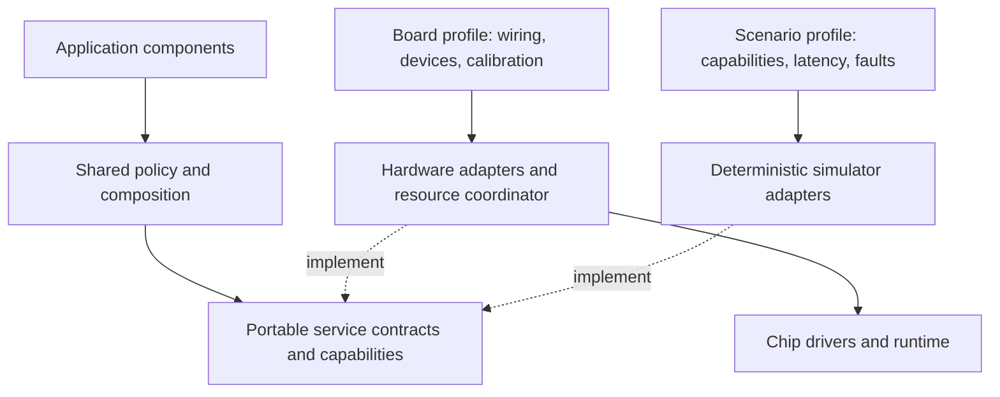
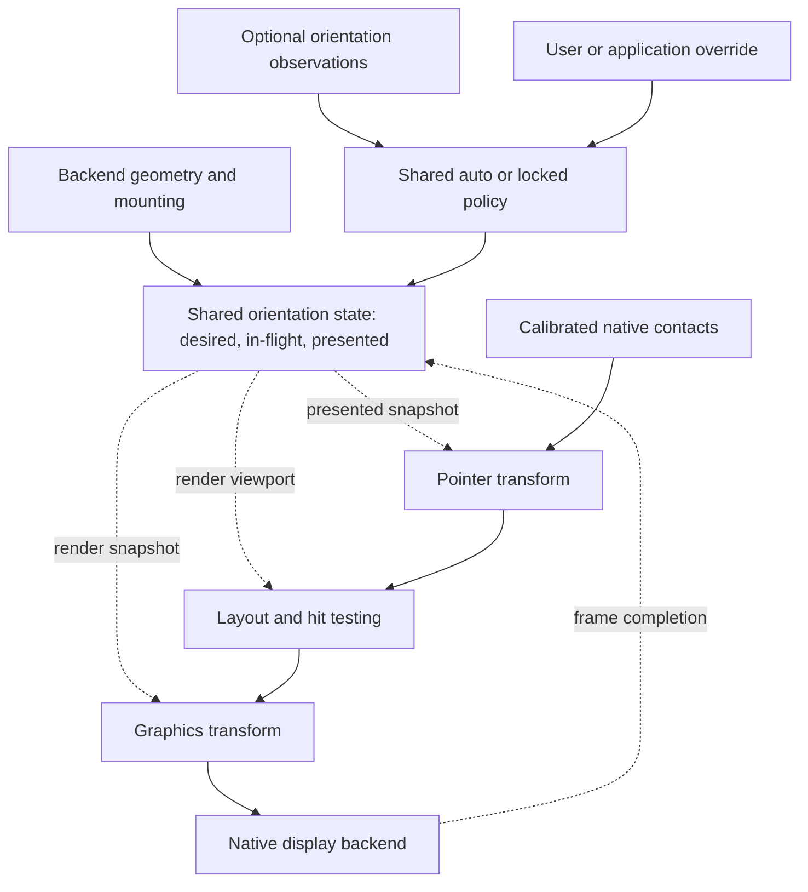

# Application architecture

The application in [`crates/app`](../crates/app/src/lib.rs) owns behavior,
application state, hit testing, and rendering across hardware and simulated
backends. It is `no_std`, uses no heap allocation, and does not select an
executor, CPU core, peripheral, or operating system. Application policy depends
on service contracts and capabilities, not a device SKU.

The platform owns resources and execution: time, input delivery, framebuffer
storage, refresh completion, hardware initialization, and scheduling. The
simulator implements these services with native Rust; physical backends implement
them using their own drivers and runtime. The current firmware target is one
backend, not the definition of those services.

## Boundaries

Shared contracts define behavior, including unsupported operations and missing
optional services. A board profile maps those contracts to fitted hardware,
resources, and calibration. The profile stays within its backend; the application
receives geometry, logical controls, observations, and supported operations.

Arrows show dependency/configuration; dashed arrows identify implementations of
the same contracts. Board conformance scenarios can use the board's constraints,
while other scenarios exercise different capability combinations. A simulator
profile does not have to describe a purchasable board.

The [service catalog](device-interfaces.md) defines portable operations, validity,
ownership, and failure behavior. [Backend profiles](hardware.md) contain physical
inventories, control mappings, resource dependencies, and evidence. The
[display contract](display-constraints.md) separates component requirements from
panel-specific performance models. Hardware findings motivate a capability or
failure case; they do not require a chip-named API or an application board check.

The contracts live in [`platform.rs`](../crates/app/src/platform.rs); shared
coordinate transforms live in
[`platform/rotation.rs`](../crates/app/src/platform/rotation.rs). Drivers
implement the contracts, and the platform loop supplies them to `App`.

| Interface | Application contract | Platform responsibility |
| --- | --- | --- |
| `Clock::now_ms()` | Monotonic milliseconds from a stable, arbitrary epoch | Keep the epoch consistent across waits and account for elapsed sleep time |
| `TouchEvent` | `Down`, `Up`, or `Cancel`; coordinates use the logical viewport, currently portrait | Decode contacts, calibrate and align axes, rotate, then deliver events in order |
| `Display` | `DrawTarget<Color = Gray4>`, `is_busy()`, and `refresh()` | Own native storage, pixel packing, refresh submission, completion, and errors |
| `App::next_deadline_ms()` | Next application timer deadline in the clock's epoch | Wait for that deadline or earlier input/driver events; choose executor and core |

These are the interfaces implemented today. A shared orientation snapshot and
viewport-change notification still need to be added; `SCREEN_SIZE` and the
application's layout are currently fixed to portrait.

The remaining catalog entries are proposed contracts, added when concrete
consumers and backends can validate them. Devices can omit optional services or
implement several services with one adapter. Capabilities describe supported
behavior; current availability separately describes readiness and faults.

The native and portrait display layers implement the same `Display` trait.
`PortraitDisplay` wraps a native display, changes its reported dimensions, and
transforms pixel writes. The application receives the wrapper, never the native
framebuffer. SPI, I2C, GPIO, DMA, and interrupts stay below this boundary.
Native targets also implement `OriginDimensions`: their origin is `(0, 0)` and
their reported size is the stable native panel size.

## Orientation state and coordinate spaces

The intended design has one shared orientation state consumed by layout,
graphics, and pointer input. The backend supplies native dimensions, mounting,
and optional orientation observations; shared policy selects logical orientation.
This state and policy are planned. The current adapter supports one fixed turn.

There are three coordinate spaces, each with a top-left origin, x increasing
right, and y increasing down:

| Space | Meaning | What changes it |
| --- | --- | --- |
| Native panel | Backend framebuffer coordinates, width `W` and height `H` | Fixed for the configured display |
| Device body | Coordinates relative to the enclosure's reference upright position | Fixed panel mounting maps native coordinates into this space |
| Logical UI | Coordinates used by layout, rendering, and hit testing | Runtime orientation relative to the device body |

The shared system layer should own an `OrientationState`. The platform supplies
geometry, mounting, and orientation observations; graphics and input adapters
consume snapshots of this state rather than deciding rotation independently.
The application uses the snapshot's logical viewport size for layout and hit
testing. It should not need the panel mounting angle or raw sensor samples.

The state separates:

- **Mounting transform:** immutable native-panel-to-device-body rotation from
  the backend's display description. Touch-controller calibration and sensor-axis
  alignment are separate fixed transforms into their respective reference spaces.
- **Logical orientation:** device-body-to-UI rotation selected by shared policy.
  An `Auto` mode uses the sensor-derived estimate; a `Locked` mode selects an
  explicit orientation. An override replaces the automatic selection, so it is
  not accidentally added to the sensor result as another rotation.
- **Effective transform:** the composition of mounting and logical orientation,
  with its inverse, logical dimensions, and a revision identifying the snapshot.
  For clockwise quarter-turns in these specified directions, the effective turn
  count is `(mounting + logical) mod 4`. Transforms also include the translations
  needed to keep rotated pixel coordinates within bounds.

If `M` maps native panel to device body and `L` maps device body to logical UI,
then native-to-logical is `T = L ∘ M`. Touch uses `T`; drawing uses `T⁻¹`.
Odd effective quarter-turns give an `H × W` viewport, and even turns give
`W × H`. Native framebuffer dimensions and storage order do not change when
logical orientation changes.

Solid arrows carry configuration, events, or drawing. Dashed arrows provide a
frame's orientation snapshot or acknowledge visible completion. Ordinary control
events do not pass through the coordinate transform.

Orientation observations are inputs to policy, not mutations made by the input
or graphics driver. The shared policy should apply stability thresholds before
selecting a new orientation and retain the last stable orientation when the
estimate is ambiguous. A simulator orientation control should inject the same
kind of observation; a manual lock should exercise the same override path.
Filtering policy still needs to be established. A backend without an automatic
orientation source reports that capability as unavailable; manual selection and
locking remain valid. The application need not know the source's chip or whether
observations came from physical hardware or a synthetic scenario.

### Changing orientation while a frame is visible

One mutable angle is insufficient for an asynchronously refreshed display. The
state needs a **desired snapshot**, an **in-flight frame snapshot** when one has
been submitted, and a **presented snapshot** describing the completed visible
frame. Layout and graphics use the same immutable snapshot for each render;
touch must never use a newer orientation than the visible UI.

The planned transition policy is to cancel an active gesture and suppress new
gestures during an orientation change. When the display is ready, recompute
layout and render a full frame using the latest desired snapshot. Associate that
snapshot with the submitted frame; promote it to presented only on successful
completion. Re-enable input when the visible orientation matches the desired
one and any existing contacts have lifted. Rejected submissions keep the previous
presented snapshot; further orientation changes coalesce into the next frame.
A failure after physical driving starts can leave a partially changed image;
mark presentation as unknown and keep input blocked until recovery completes.
The platform loop serializes these transitions, avoiding partial updates to
layout, drawing, and input transforms.

### Implemented fixed orientation

Today `PortraitRotation` implements an effective clockwise quarter-turn without
separate mounting, policy, or runtime state. For native height `H`, it maps
native `(x, y)` to logical `(H - 1 - y, x)` and logical `(x, y)` to native
`(y, H - 1 - x)`. This exercises the pixel and touch transformations, but does
not yet implement the orientation
state and transitions described above. It does not establish which part of that
turn belongs to the actual panel mounting.

`PortraitDisplay` writes directly into the native target; it allocates no second
framebuffer. Pixels outside portrait bounds are clipped before transformation.
Contiguous color streams retain their positions when clipped, and a clear is
forwarded to the native display. Refresh calls, busy state, and errors pass
through unchanged. The current adapter implements this one fixed quarter-turn;
runtime orientation changes are not yet part of the application interface.

Touch drivers first produce pixel coordinates aligned with the native panel,
then use `PortraitRotation::touch_to_portrait`. Raw touch-controller ranges and
axis conventions are a driver concern. Invalid coordinates become `Cancel`, so
they cannot leave an armed gesture behind. The app counts a tap only when both
down and up occur inside the target.

The simulator currently follows both fixed-orientation paths: it renders through
`PortraitDisplay` into native storage, and converts browser contact positions
into native input before passing them through the shared touch rotation. PNG
presentation rotates the completed native image back into the portrait view.
That temporary export buffer belongs to the simulator, not to the application
drawing path.
With runtime orientation, the simulator's device pose must be independent of
the logical UI override: rotating the enclosure changes its presentation, while
locking UI orientation changes content within it. Exporting a frame must use
that frame's associated state, never the latest desired orientation.

## Display lifecycle and ownership

Component behavior and future display interfaces follow the
[display contract](display-constraints.md): damage, quality intent, capabilities,
completion, and recovery. Backend-specific cost estimates can inform scheduling
without exposing scan algorithms or panel identifiers. A future shared
compositor/display policy combines component damage using the orientation
snapshot before submitting work. The current direct `App` → `Display` path is
the initial implementation.

Drawing changes staging storage. `refresh()` returning `Ok(())` means the frame
was accepted; it does not mean the panel has finished. While `is_busy()` is true,
the application submits neither drawing nor another refresh. Input and timers
can continue to update application state.
The physical panel can visibly change throughout a refresh. A "presented"
snapshot means the last completed target, not a claim of an atomic optical swap.

`App::present()` renders only when dirty and ready. It clears the dirty flag
after successful submission, coalescing changes received while busy into the
next frame. Drawing or submission errors leave the app dirty for a retry.
Driver recovery and retry backoff belong to the platform. There is currently no
separate application notification for an asynchronous failure after acceptance;
a driver must recover an accepted frame or that contract must be extended.

Native drivers own all buffers and keep in-flight transfer data valid until
completion, including when DMA or another core is involved. `Gray4` specifies
16 logical gray levels, not byte layout or allocation strategy. The simulator
uses one byte per pixel and separate staging, pending, and visible frames. A
hardware driver can use packed pixels and a different buffering strategy while
preserving the same submission/busy contract.

## Scheduling and implementation status

The platform serializes calls into `App`; no shared mutable application state or
cross-core locking is required by the current design. On a wakeup, service driver
completion and input, call `tick(clock)`, then call `present()` through the
portrait adapter when a display is available. Wait for the earliest application
deadline, input event, or driver completion. The app currently has a 30-second
heartbeat and reports at most one heartbeat after a late poll without shifting
the original cadence.

The simulator advances a virtual clock through application and refresh deadlines
in order. The first firmware backend uses Embassy time and schedules the shared
heartbeat on core 0; display and touch are not initialized. See
[simulator.md](simulator.md) and the [backend profiles](hardware.md) for their
implementation details.

The intended separation is not fully realized in code yet. In particular,
`platform.rs` defines `NATIVE_SCREEN_SIZE = 960 × 540` and `SCREEN_SIZE = 540 × 960`,
and `App` derives fixed layout and hit regions from those constants. These are
the current demo's geometry, not a portable service requirement.
`PortraitRotation` already accepts native dimensions, but application layout
still needs a supplied logical viewport. The next implementation should move
geometry selection into backend/scenario setup, introduce control and capability
descriptors as their consumers arrive, and test a different geometry and missing
optional services. This documentation separation does not claim those runtime
changes have already happened.

The next orientation work is to introduce the shared state and policy, make
layout use its viewport, generalize the adapters to all four quarter-turns, and
associate orientation snapshots with submitted/completed frames. The simulator
should then exercise mounting configuration, automatic observations, and manual
locks through those same interfaces.

The [device interface design](device-interfaces.md) specifies the planned
observations, operations, lifecycle, failure behavior, and acceptance scenarios
for the remaining services. Implement each contract when a real consumer and
backend can validate it, with deterministic simulator scenarios alongside it.
OTA and multicore work queues remain separate implementation decisions. Keep
protocol/state decisions in shared code and peripheral mechanics in drivers.

## Verification

`just ci`, run inside the devcontainer, checks native and Xtensa builds. Tests
cover fixed corner mappings, asymmetric pixel patterns, clipped color streams,
touch cancellation, error propagation, delayed frame visibility, and timer
cadence. An integration test compares the portrait export of the native buffer
against an independent direct portrait rendering, pixel for pixel. Both native
and portrait snapshots are emitted as CI artifacts. These checks do not validate
panel waveforms, electrical timing, power consumption, or real driver behavior.
Runtime orientation will additionally need scenarios for overrides, changing
orientation during a touch or refresh, coalesced changes, and failed submissions
without mismatching the visible layout and touch mapping.
Display-performance scenarios and the measurements needed to calibrate them are
listed in [display-constraints.md](display-constraints.md#simulator-and-hardware-validation).
