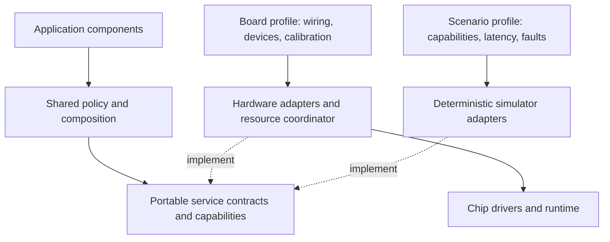
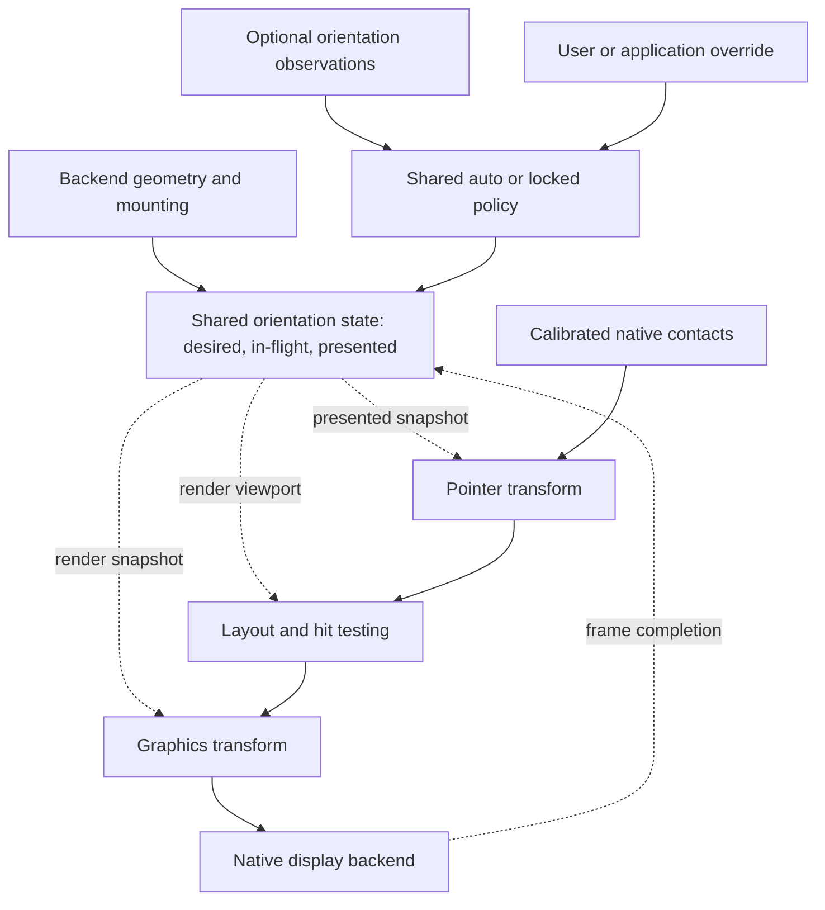

# Application architecture

The application in [`crates/app`](../crates/app/src/lib.rs) controls shared
behavior, state, hit testing, and rendering. It is `no_std` and uses no heap
allocation. It does not select an executor, CPU core, peripheral, or operating
system. Application policy uses service contracts and capabilities.
It does not depend on a device SKU.

The platform controls resources and execution. These include time, input
delivery, framebuffer storage, refresh completion, hardware initialization,
and scheduling. The simulator implements these services with native Rust.
Physical backends use their own drivers and runtime.
The current firmware target is one implementation of these services.

## Boundaries

Shared contracts define behavior, including unsupported operations and missing
optional services. A board profile maps these contracts to fitted hardware,
resources, and calibration. The profile stays in its backend.
The application receives geometry, logical controls, observations, and supported
operations.

Solid arrows show dependencies or configuration.
Dashed arrows identify implementations of the same contracts.
Board conformance scenarios can use the board's constraints.
Other scenarios use different capability combinations.
A simulator profile can give information about a synthetic device.

The [service catalog](device-interfaces.md) defines portable operations, validity,
ownership, and failure behavior. [Backend profiles](hardware.md) contain physical
inventories, control mappings, resource dependencies, and evidence.
The [display contract](display-constraints.md) separates component requirements
from panel performance models. Hardware findings identify necessary capabilities
or failure cases. These findings do not justify chip names in APIs or board
checks in application code.

The contracts are in [`platform.rs`](../crates/app/src/platform.rs).
Shared coordinate transforms are in
[`platform/rotation.rs`](../crates/app/src/platform/rotation.rs).
Drivers implement the contracts. The platform loop supplies them to `App`.

| Interface | Application contract | Platform responsibility |
| --- | --- | --- |
| `Clock::now_ms()` | Monotonic milliseconds from a stable, arbitrary epoch | Keep the same epoch across waits. Include elapsed sleep time. |
| `TouchEvent` | `Down`, `Up`, or `Cancel`, with logical viewport coordinates. The current viewport is portrait. | Decode contacts. Calibrate and align axes. Rotate coordinates. Deliver events in order. |
| `Display` | `DrawTarget<Color = Gray4>`, `is_busy()`, and `refresh()` | Control native storage, pixel packing, refresh submission, completion, and errors. |
| `App::next_deadline_ms()` | Next application timer deadline in the clock's epoch | Wait for the deadline or earlier input or driver events. Select the executor and core. |
| `Discovery` | Identified Wi-Fi or Bluetooth LE scans, bounded results, source, completion time, cancellation, and errors | Supply observations. Control radio resources. Report a missing adapter as unsupported. |

The code implements these interfaces. Shared orientation snapshots and viewport
change notifications stay planned work.
`SCREEN_SIZE` and application layout currently use a fixed portrait orientation.

The remaining catalog operations are proposed contracts.
Their implementation must have consumers and backends that validate their
behavior. Devices can omit optional services or implement multiple services
with one adapter. Capabilities give information about supported behavior.
Availability gives information about current readiness and faults.

The native and portrait display layers implement the same `Display` trait.
`PortraitDisplay` wraps a native display, changes its reported dimensions, and
transforms pixel writes. The application receives this wrapper.
It does not receive the native framebuffer.
SPI, I2C, GPIO, DMA, and interrupts stay below this boundary.

Native targets also implement `OriginDimensions`.
Their origin is `(0, 0)`.
Their reported size is the stable native panel size.

## Radio debugger

The shared application controls the debugger, touch targets, result order, and rendering.
Wi-Fi results identify access points by BSSID.
Bluetooth LE results identify devices by address and address type.
The debugger does not connect to networks or pair with devices.
The simulator uses test data and shows `SIMULATED DATA` on the device screen.
Firmware supplies physical observations through its radio worker.
The [backend profile](boards/lilygo-t5-s3-pro.md#radio-discovery) specifies its drivers and limits.

Firmware stores the application and scan results in static RAM.
`ConstStaticCell` supplies exclusive access to this storage without heap allocation.
`App::new_at(0)` uses the platform epoch as the firmware start time.

`ScanResults` stores up to 24 entries without heap allocation.
It sorts measured RSSI from highest to lowest, then puts unknown RSSI last.
Thus, -38 dBm precedes -73 dBm.
Equal values use address order, then address type.
A new report replaces the previous report for the same address and address type.
Different addresses keep separate entries, even when names are the same.

The debugger shows five entries per page.
An empty name appears as `Hidden network` or `Unnamed device`.
The adapter replaces name bytes outside printable ASCII with question marks for the display font.
Names have a maximum length of 32 bytes.
The screen shows the scan time and the result limit when overflow occurs.

The platform calls `App::poll_discovery` for requests, completions, and deadlines.
Each scan has an ID, a radio kind, and a deadline in the application epoch.
The consumer supplies a result buffer to `Discovery::poll`.
The adapter replaces that buffer only when it returns a completion.
An error completion clears the buffer.
This interface avoids a complete result buffer on the firmware stack.
The application rejects a completion for a different request.
It cancels a scan after 10 seconds without a valid completion.
The next application deadline includes this timeout.

A tab change or exit cancels the active scan.
Cancellation invalidates the request immediately.
An asynchronous adapter releases its resources before the next physical scan starts.
Accepted replacement requests keep their original deadline while they wait for resource release.
The backend notifies the platform loop when results are ready.
A new scan clears previous results and resets pagination.
The adapter reports its source when it accepts a request.
Scan errors stay visible until another request.
The simulator completes a scan after 1.5 virtual seconds.
These delays are test conditions, not hardware measurements.

## Orientation state and coordinate spaces

The planned design has one shared orientation state for layout, graphics, and
pointer input. The backend supplies native dimensions, mounting information,
and optional orientation observations. Shared policy selects the logical
orientation. This state and policy stay planned work.
The current adapter supports one fixed turn.

Each coordinate space has a top-left origin.
The x coordinate increases to the right.
The y coordinate increases downward.

| Space | Meaning | What changes it |
| --- | --- | --- |
| Native panel | Backend framebuffer coordinates, with width `W` and height `H` | Fixed for the configured display |
| Device body | Coordinates relative to the enclosure's upright reference position | Fixed panel mounting maps native coordinates into this space |
| Logical UI | Coordinates for layout, rendering, and hit testing | Runtime orientation relative to the device body |

The shared system layer will control an `OrientationState`.
The platform will supply geometry, mounting information, and orientation
observations. Graphics and input adapters will use snapshots of this state.
They will not select rotation independently.
The application will use the snapshot's logical viewport for layout and hit
testing. It will operate without the panel mounting angle or raw sensor samples.

The state has three parts:

- **Mounting transform:** fixed rotation from native panel coordinates to
  device-body coordinates. The backend supplies this transform.
  Touch calibration and sensor-axis alignment use separate fixed transforms.
  Each transform maps into its applicable reference space.
- **Logical orientation:** rotation from device-body coordinates to UI
  coordinates. Shared policy selects this rotation.
  `Auto` mode uses the sensor estimate.
  `Locked` mode selects an explicit orientation.
  An override replaces automatic selection instead of adding another rotation.
- **Effective transform:** composition of the mounting transform and logical
  orientation. The state includes the inverse, logical dimensions, and a
  revision that identifies the snapshot.
  For clockwise quarter-turns in these directions, the turn count is
  `(mounting + logical) mod 4`.
  Translations keep rotated pixel coordinates within bounds.

`M` maps the native panel to the device body.
`L` maps the device body to the logical UI.
Thus, the native-to-logical transform is `T = L ∘ M`.
Touch input uses `T`. Drawing uses `T⁻¹`.

Odd effective quarter-turns give an `H × W` viewport.
Even turns give a `W × H` viewport.
Native framebuffer dimensions and storage order stay the same when logical
orientation changes.

Solid arrows carry configuration, events, or drawing operations.
Dashed arrows supply an orientation snapshot or report frame completion.
Ordinary control events do not use the coordinate transform.

Orientation observations are policy inputs.
Input and graphics drivers do not change orientation policy.
Shared policy will apply stability thresholds before it selects a new
orientation. An ambiguous estimate will keep the last stable orientation.
The filter policy stays undecided.

A simulator orientation control will supply the same type of observation.
A manual lock will use the same override path as hardware.
A backend without an automatic orientation source reports that capability as
unavailable. Manual selection and orientation locks stay possible.
The application operates without the source's chip name or its physical or
synthetic origin.

### Changing orientation while a frame is visible

One mutable angle cannot represent all states of an asynchronous display refresh.
The state must have a **desired snapshot**, an **in-flight frame snapshot**, and a
**presented snapshot**. The in-flight snapshot identifies a submitted frame.
The presented snapshot identifies the last completed visible frame.
Layout and graphics use the same immutable snapshot for each render.
Touch must not use an orientation newer than the visible UI.

The planned transition has these steps:

1. Cancel an active gesture.
2. Block new gestures during the orientation change.
3. When the display is ready, compute layout from the latest desired snapshot.
4. Render a full frame with that snapshot.
5. Associate the snapshot with the submitted frame.
6. After successful completion, make that snapshot the presented snapshot.
7. When visible and desired orientations match and last contacts end, enable input again.

A rejected submission keeps the last presented snapshot.
Further orientation changes combine into the next frame.
A failure during physical driving can leave a partially changed image.
The platform marks presentation as unknown and blocks input until recovery
completes. The platform loop serializes these transitions.
Thus, layout, drawing, and input transforms cannot receive partial state changes.

### Implemented fixed orientation

`PortraitRotation` implements one effective clockwise quarter-turn.
It has no separate mounting transform, policy, or runtime state.
For native height `H`, it maps native `(x, y)` to logical `(H - 1 - y, x)`.
It maps logical `(x, y)` to native `(y, H - 1 - x)`.
These mappings exercise pixel and touch transforms.
They do not identify the actual panel mounting angle.

`PortraitDisplay` writes directly into the native target.
It allocates no second framebuffer.
It clips pixels outside portrait bounds before transformation.
Clipping keeps positions in contiguous color streams.
A clear operation passes to the native display.
Refresh calls, busy state, and errors pass through unchanged.

Touch drivers first produce pixel coordinates aligned with the native panel.
They then use `PortraitRotation::touch_to_portrait`.
Drivers control raw coordinate ranges and axis conventions.
Invalid coordinates produce `Cancel`, which cancels an armed gesture.
The application counts a tap only when both down and up occur in the target.
Runtime orientation changes stay outside the current interface.

The simulator uses both fixed-orientation paths.
It renders through `PortraitDisplay` into native storage.
It converts browser contact positions into native input before the shared touch
rotation. PNG export rotates the completed native image into the portrait view.
The temporary export buffer belongs to the simulator.
The application does not draw into that buffer.

With runtime orientation, simulator device pose must stay independent of the
logical UI override. Enclosure rotation changes the device presentation.
An orientation lock changes content within that enclosure.
Frame export must use the state associated with that frame.
It must not use the latest desired orientation.

## Display lifecycle and ownership

Future component behavior and display interfaces use the
[display contract](display-constraints.md).
This contract covers damage, quality intent, capabilities, completion, and
recovery. Backend cost estimates can inform scheduling without scan algorithms
or panel identifiers in shared policy.

A planned shared compositor and display policy will combine component damage
through the orientation snapshot before submission.
The current implementation uses a direct `App` → `Display` path.

Drawing changes staging storage.
A `refresh()` result of `Ok(())` confirms acceptance of the frame.
It does not confirm panel completion.
While `is_busy()` is true, the application submits no drawing operations or
more refreshes. Input and timers can update application state.

A physical panel can change visibly throughout a refresh.
A presented snapshot identifies the last completed target.
It does not indicate an atomic optical replacement.

`App::present()` renders only when the application is dirty and the display is
ready. Successful submission clears the dirty flag.
Changes that arrive while busy combine into the next frame.
Drawing errors or submission errors leave the application dirty for a retry.
The platform controls driver recovery and retry delays.

The current interface has no shared notification for asynchronous failure after acceptance.
The firmware runtime receives these failures through its completion channel and disables the display.
Input and heartbeat service continue. Shared application recovery stays planned work.

Native drivers own all buffers.
They keep transfer data valid until completion, including work through DMA or
another core. `Gray4` specifies 16 logical gray levels.
It does not specify byte layout or allocation strategy.

The simulator uses one byte per pixel with separate staging, pending, and
visible frames. A hardware driver can use packed pixels and a different buffer
strategy. It must obey the submission and busy-state contract.

## Scheduling and implementation status

The platform serializes calls into `App`.
Application state stays on one core.
The firmware transfers exclusive panel ownership through channels between cores.
Each wakeup uses this sequence:

1. Process driver completion and input events.
2. Call `tick(clock)`.
3. If a display is available, call `present()` through the portrait adapter.
4. Wait for the earliest application deadline, input event, or driver completion.

The application has a 30-second heartbeat.
A late poll produces at most one heartbeat and keeps the initial schedule.
The simulator advances virtual time through application and refresh deadlines
in order. The firmware backend uses Embassy time.
The application, heartbeat, and touch service run on core 0.
A worker on core 1 executes display refreshes.
Submission transfers the panel and both framebuffers to that worker.
The client reports busy until completion returns ownership.
Thus, the application cannot change a frame during its scan.

Touch interrupts wake a separate executor on core 0.
The application consumes touch events during display work and combines changes into the next frame.
A mutex serializes I2C access for touch reports and display controls.
It leaves interrupts enabled during transfers and releases the bus before display scans or supply waits.
The GPIO handler only records the interrupt time and wakes the touch worker.

The application renders each new image through the same display contract.
The adapter compares it with the last completed image to select full or partial updates.
Only changed pixels receive active commands during a partial update.
The adapter saves the new image only after the update succeeds.

The application waits for touch events, display completion, discovery changes, or its next deadline.
Read failures or event queue overflow cancel the active gesture.
A display error stops further display updates and reports the fault through USB.
Heartbeat output continues after a display error.
These changes preserve the existing application contracts.

The [simulator guide](simulator.md) and [backend profiles](hardware.md) give information about
each implementation. The code does not yet implement the full separation.
`platform.rs` defines `NATIVE_SCREEN_SIZE = 960 × 540` and
`SCREEN_SIZE = 540 × 960`.
`App` derives fixed layout and hit regions from these constants.
These dimensions apply to the current demonstration.
They are not portable service requirements.

`PortraitRotation` accepts native dimensions.
Application layout must receive a logical viewport.
The next implementation will move geometry selection into backend and scenario
setup. Control and capability descriptors must have concrete consumers.
Tests will include different geometry and missing optional services.
These runtime changes stay planned work.

The next orientation work will add shared state and policy.
Layout will use the state's viewport.
Adapters will support all four quarter-turns.
Submitted and completed frames will carry orientation snapshots.
Simulator scenarios will use these interfaces for mounting configuration,
automatic observations, and manual locks.

The [device interface design](device-interfaces.md) specifies planned service
observations, operations, lifecycles, failures, and acceptance scenarios.
Each contract must have a consumer, a backend, and deterministic simulator
scenarios. OTA stays a separate design decision.
Shared code controls protocol and state decisions.
Drivers control peripheral operations.

## Verification

`just ci` checks native and Xtensa builds in the devcontainer.
Tests cover corner mappings, asymmetric pixel patterns, clipped color streams,
touch cancellation, error propagation, delayed frame visibility, and timer
intervals. An integration test compares portrait export with independent direct
portrait rendering, pixel for pixel.
CI produces native and portrait snapshots as artifacts.

These checks do not verify panel waveforms, electrical timing, power consumption,
or physical driver behavior.
Runtime orientation scenarios must include overrides and rotation during
a touch or refresh. They must also include combined changes and failed submissions.
The visible layout and touch mapping must agree in all cases.
[Display validation](display-constraints.md#simulator-and-hardware-validation)
gives information about performance scenarios and calibration measurements.
