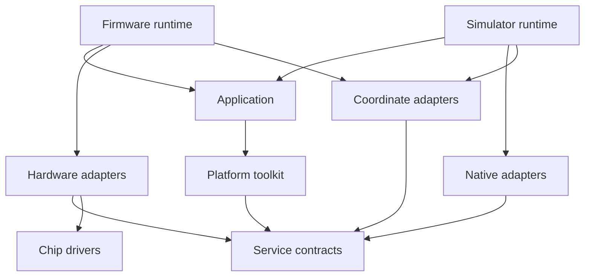

# Software architecture

The project has an application, a platform toolkit, and backend implementations.
The platform contains common functionality for application development.
Applications combine toolkit components into their screens and workflows.
The toolkit has no dependency on a particular application.

## Boundaries

| Code | Responsibility | Project dependencies |
| --- | --- | --- |
| [`crates/app`](../crates/app/src/lib.rs) | Application state, screens, layout, actions, and policy choices | `paper-mesh-platform` |
| [`crates/platform`](../crates/platform/src/lib.rs) | Application toolkit and portable contracts | None |
| [`crates/gnss`](../crates/gnss/README.md) | Portable NMEA decoding, acquisition, and optional baud probing | Platform serial and location contracts |
| [`crates/bq25896`](../crates/bq25896/README.md) | Charger observations and guarded battery isolation through I2C | Platform charger state |
| [`crates/bq27220`](../crates/bq27220/README.md) | Portable fuel-gauge observations through I2C | Platform battery state |
| [`crates/pcf8563`](../crates/pcf8563/src/lib.rs) | PCF8563 calendar access through I2C | Platform calendar contract |
| [`firmware/src/main.rs`](../firmware/src/main.rs) | Hardware startup and connection of the application to services | Application, platform, and hardware adapters |
| [`crates/esp-adapters`](../crates/esp-adapters/README.md) | ESP USB transport, RTC clock, touch input, and lifecycle handles | Platform, HID protocol, PCF8563, and GT911 drivers |
| [`firmware/src`](../firmware/src/main.rs) adapters | Hardware services, drivers, buffers, and resource control | Platform and chip drivers |
| [`simulator/src/lib.rs`](../simulator/src/lib.rs) | Native services and deterministic application execution | Application and platform |
| [`simulator/src/main.rs`](../simulator/src/main.rs) | HTTP transport and wall-clock pacing | Simulator and platform |
| [`crates/hid-touchpad`](../crates/hid-touchpad/README.md) | Host HID descriptors and contact encoding | Platform |
| [`crates/ed047tc1`](../crates/ed047tc1/src/lib.rs), [`crates/gt911`](../crates/gt911/src/lib.rs) | Chip protocols and display encoding | None |

Both shared crates use `no_std` without heap allocation.
The root workspace also builds the simulator and tests the chip and host protocols.
Firmware stays outside that workspace to isolate Xtensa settings and ESP dependency features.
Firmware owns [interrupt routing](platform/runtime.md#interrupt-ownership) and dispatches adapter GPIO callbacks through the shared vector.
Firmware owns [execution placement](platform/runtime.md#firmware-execution-placement), including executor storage, core assignment, and software-interrupt priorities.
Adapters receive spawners or expose worker futures. Firmware owns shared GPIO routing through adapter-supplied registrations.
Its manifest uses path dependencies for the application, platform, and adapter crates.
The ESP adapter crate participates in native checks with hardware features disabled. Firmware enables its `esp32s3` feature explicitly.

Firmware [features](../firmware/src/features.rs) compose adapter capabilities with runtime policy.
Each integration has its own submodule. Adapter mechanisms remain separate from these firmware connections.

The platform owns calendar synchronization through its `Rtc` contract.
The PCF8563 crate implements that contract without ESP peripherals or executor dependencies.
The platform has no dependency on the PCF8563 crate.
The ESP adapter crate owns RTC clock reads, lifecycle handling, the polling loop, and the concrete Embassy task.
Firmware retains synchronization policy, state storage, shared bus ownership, task startup, and system suspend coordination.
RTC preparation hides bus capacity in one boxed future. Firmware launches its `WorkerSet` through the selected executor.
The platform supplies [bus arbitration](platform/shared-bus.md) for asynchronous and synchronous clients without hardware dependencies.
Firmware selects the bus driver, pins, storage, raw mutex, and queue capacity.
The platform supplies a [worker pause channel](platform/worker-coordination.md) with separate controller and worker endpoints.
The runtime initializes RTC storage with its synchronization policy and splits matching clock and worker endpoints.
The clock control handle implements the platform [suspend participant contract](services/power.md#suspend-participants).
The runtime supplies that handle to the suspend controller through the generic contract.
The handle also implements the independent [power-off participant contract](services/power.md#power-off-participants).
The runtime supplies this capability separately to the power-off coordinator.
Power-off faults use watchdog reset and the normal startup checks before workers restart.
RTC, USB, button-polling, power-observation, and GNSS workers use explicit pause handles.
Touch uses [acquisition control](platform/readiness.md#acquisition-control) to separate driver quiescence from logical input preparation.
The runtime combines their lifecycle handles in [service composition](../firmware/src/lifecycle.rs).
The hardware coordinator remains independent of the selected adapters.
The coordinator retains a system admission flag, but no global worker registry.
The runtime GNSS worker reports hardware preparation failures through its lifecycle handle.
The worker reads shared synchronization state after each pause so lifecycle invalidation reaches its next poll.
Runtime configuration supplies polling intervals, observation age limits, correction thresholds, and calendar range to the synchronization service.
Startup supplies location observations through a callback, so the RTC worker does not depend on the GNSS adapter.
Firmware supplies startup probe candidates and retry timing separately from GNSS observation timing.
The [portable GNSS crate](../crates/gnss/README.md) owns decoding, observation expiry, acquisition, and optional startup probing.
It borrows receiver storage and accepts runtime callbacks for monotonic time, deadlines, and observation publication.
The [serial session contract](platform/serial.md) keeps UART ownership and ESP sleep preparation outside GNSS decoding.
Receiver decoding consumes observation settings. The runtime owns probing and recovery policy.
The firmware auxiliary-rail component owns power access shared by GNSS and LoRa.
A firmware coordinator prepares consumers before cutting the rail and restores power before releasing them.
The ESP serial adapter handles UART preparation. GNSS has no shared-I2C or supply-control dependency.
The runtime worker exposes lifecycle control separately from task launch. Rail admission blocks acquisition until the coordinator establishes usable power.

The platform defines the [reply transport contract](services/connectivity.md#reply-transport) and [bounded request framing](services/connectivity.md#request-framing).
Firmware selects frame capacity and owns JSON parsing and command routing.
USB owns transport state and implements acknowledged replies. The runtime supplies command dispatch.
The runtime also supplies USB identity and the HID descriptor through startup configuration.
It selects connection diagnostics and encodes command errors outside the USB transport.
USB retains buffers, endpoint settings, worker ownership, and lifecycle coordination.
Runtime configuration supplies the protocol request limit, which USB validates against its fixed buffer capacity.
ROM download and display inspection handlers depend on the platform contract instead of the USB module.
The [ESP adapter crate](../crates/esp-adapters/README.md) owns USB hardware, session tracking, the RTC clock, touch input, and their lifecycle coordination.
USB preparation returns its lifecycle handle and a worker set that implements the platform contract. Firmware selects its spawner through `Execution::spawn`.
Firmware retains board configuration, command dispatch, diagnostic providers, and system power coordination.
Touch adapters produce platform `TouchFrame` values under the [contact-frame contract](services/input.md#contact-frame-contract).
GT911 register access stays in the chip driver. The ESP touch adapter converts reports and handles contact continuity and event delivery.
A reusable [GPIO readiness provider](adapters/gpio-readiness.md) supplies acquisition notifications and owns pin masking, acknowledgement, and rearming.
Firmware connects its signal, wake handle, and interrupt registration without a separate board crate.
The [touch adapter](adapters/touch.md) receives geometry, HOME delivery, wake coordination, and refresh diagnostics through runtime configuration.
Touch preparation accepts a shared ESP bus with runtime-selected queue capacity. The adapter owns its task, while firmware selects the spawner.
One boxed worker future hides the capacity from the task type without changing bus arbitration.

Arrows show code dependencies.
`paper-mesh-platform` does not depend on `paper-mesh-app`.
Backend adapters import service types directly from `paper-mesh-platform`.
Runtime code connects the application to backend services.
The application crate does not export the platform API.

The Diagnostics menu, component pages, pattern sequence, and input policy belong to the application crate.
The runtime supplies control identities and display completion events.
USB inspection reads a held frame without starting a display operation.
The display backend retains power sequencing and resource ownership.
The [display profile](boards/lilygo-t5-s3-pro-display.md#basic-display-check) defines the hardware procedure and its limits.

The [clock contract](services/time.md) separates monotonic deadlines from optional UTC calendar time.
The RTC backend consumes complete GNSS observations and controls persistent calendar access.
The platform supplies calendar types and elapsed-time conversion without hardware dependencies.

The [power contract](services/power.md) separates battery observations from charger observations.
Backends control device access and measurement conversion. The application controls the detail screen and observation age limits.
Firmware separates [power observations](../firmware/src/power/observation.rs) from [power-off control](../firmware/src/power/mod.rs).
The observation module owns cached snapshots, notifications, immediate reads, and worker lifecycle coordination.
The runtime selects its polling interval. Power-off checks and battery isolation do not depend on the observation worker.
The application also requests explicit lifecycle transitions through portable request and error types.
The runtime coordinates display completion and service preparation before the backend changes system power.
Hardware recovery deadlines and retained fault records stay in the firmware backend.

Common functionality belongs in the platform crate.
Toolkit components accept application choices through parameters and callbacks.
Modules group related functions by responsibility.
The current application is one toolkit consumer.
Future applications can use the same components without a dependency on its screens.

[Composition](platform/composition.md) owns a shared layer hierarchy with scoped roots and atomic updates.
The [UI](platform/ui.md) system supplies elements, layout, and callbacks. Layout writes explicit geometry into layers.
The calculator owns decimal arithmetic, control policy, and its element composition.
The current renderer uses complete redraws. Backends retain physical refresh policy.

The platform Navigator owns layers, shell launch, page lifetimes, return history, focus, and the soft keyboard.
The Shell supplies the shared header and Back region.
Pages retain elements and models. The system assigns their layer roots.
Touchscreen recognition emits opaque handler tokens. The UI runtime invokes callbacks after traversal.
Custom drawing slots preserve application renderers within layer clipping.
Frame completion acknowledges a submitted revision, independent of the current destination.
The application supplies concrete page storage, identities, style, geometry, and operation restrictions.
The navigator owns the supplied page collection. Its callbacks coordinate application service state.
The shell supports full-screen presentation without changing the reserved Home-key binding.

The [shared UI standard](ui.md) defines common behavior and visual roles.
The [application UI rules](application-ui.md) define current application choices.

The [UI guide](simulator/execution.md#ui-guide) runs independent examples from `crates/app/examples/ui_guide/` through the native host.
Its retained-layout example uses the production calculator page in an independent session.
These examples use platform components and have no device service connections.
The simulator supplies their HTTP transport and PNG output. Firmware does not include them.

A board profile maps contracts to fitted hardware, resources, and calibration.
A scenario profile supplies simulated observations, delays, and faults.
These profiles do not select application behavior by board name.
The application uses service results and logical coordinates.

## Application and platform decisions

| Decision | Owner |
| --- | --- |
| Screen workflows, control placement, action bindings, pagination, and unit selection | Application |
| Common controls, tap recognition, value formatting, timers, and age checks | Platform toolkit |
| Scan requests, request deadlines, and observation age limits | Service consumer |
| Observation units, validity fields, result capacity, and completion rules | Platform contract |
| Native dimensions, transport settings, resources, and driver recovery | Backend |
| Coordinate conversion, event delivery, and execution | Platform |
| Current application layout and its required logical viewport | Application |
| Connection of that viewport to a native display | Runtime and coordinate adapter |

Service consumers select deadlines and validity limits.
The toolkit accepts these choices without a dependency on a particular screen.
Portable contracts define shared data rules and service outcomes.
The [application](application.md) and [platform topics](platform.md#detailed-topics) describe their specific behavior.

## Detailed design and implementation

The [documentation map](../DOCUMENTATION.md#document-map) identifies the primary documents.
The [application](application.md) records screen behavior and policy values.
The [platform](platform.md) describes common responsibilities and links to toolkit and runtime topics.
The [device services](device-interfaces.md) identify current interfaces and planned contracts.
The [backend profiles](hardware.md) record adapter status, hardware limits, and remaining verification.

The current application is one consumer of this architecture.
Its layout and current adapters do not define requirements for future applications.
Each topic identifies its implementation limits.
A crate boundary does not imply completion of planned services.

## Verification

The [development guide](development.md#continuous-integration) defines the build and CI procedure.
Platform tests verify common behavior and contracts.
Application tests verify screen interactions and policy choices.
Simulator tests connect the application to native services.
Backend tests verify driver logic where native execution is possible.

Native checks do not verify electrical timing, panel waveforms, or physical driver behavior.
[Backend profiles](hardware.md) specify the necessary hardware checks.
