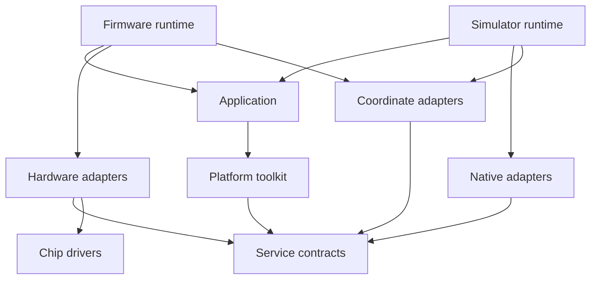

# Software architecture

The project has an application, a platform toolkit, and backend implementations.
The platform contains common functionality for application development.
Applications combine toolkit components into their screens and workflows.
The toolkit has no dependency on a particular application.

## Boundaries

| Code | Responsibility | Project dependencies |
| --- | --- | --- |
| [`crates/app`](../crates/app/src/lib.rs) | Application state, screens, layout, actions, and policy choices | `paper-mesh-platform` |
| [`crates/platform`](../crates/platform/src/lib.rs) | Application toolkit and portable contracts | None |
| [`firmware/src/main.rs`](../firmware/src/main.rs) | Hardware startup and connection of the application to services | Application, platform, and hardware adapters |
| [`firmware/src`](../firmware/src/main.rs) adapters | Hardware services, drivers, buffers, and resource control | Platform and chip drivers |
| [`simulator/src/lib.rs`](../simulator/src/lib.rs) | Native services and deterministic application execution | Application and platform |
| [`simulator/src/main.rs`](../simulator/src/main.rs) | HTTP transport and wall-clock pacing | Simulator and platform |
| [`crates/ed047tc1`](../crates/ed047tc1/src/lib.rs), [`crates/gt911`](../crates/gt911/src/lib.rs) | Chip protocols and display encoding | None |

Both shared crates use `no_std` without heap allocation.
The root workspace also builds the simulator and tests the chip protocols.
Firmware stays outside that workspace to isolate Xtensa settings and ESP dependency features.
Its manifest uses path dependencies for both shared crates.

Arrows show code dependencies.
`paper-mesh-platform` does not depend on `paper-mesh-app`.
Backend adapters import service types directly from `paper-mesh-platform`.
Runtime code connects the application to backend services.
The application crate does not export the platform API.

The [clock contract](services/time.md) separates monotonic deadlines from optional UTC calendar time.
The RTC backend consumes complete GNSS observations and controls persistent calendar access.
The platform supplies calendar types and elapsed-time conversion without hardware dependencies.

The [power contract](services/power.md) separates battery observations from charger observations.
Backends control device access and measurement conversion. The application controls the detail screen and observation age limits.

Common functionality belongs in the platform crate.
Toolkit components accept application choices through parameters and callbacks.
Modules group related functions by responsibility.
The current application is one toolkit consumer.
Future applications can use the same components without a dependency on its screens.

A board profile maps contracts to fitted hardware, resources, and calibration.
A scenario profile supplies simulated observations, delays, and faults.
These profiles do not select application behavior by board name.
The application uses service results and logical coordinates.

## Application and platform decisions

| Decision | Owner |
| --- | --- |
| Screen workflows, control placement, action bindings, pagination, and unit selection | Application |
| Common controls, tap recognition, value formatting, timers, and age checks | Platform toolkit |
| Scan requests, request deadlines, and observation age limits | Service consumer |
| Observation units, validity fields, result capacity, and completion rules | Platform contract |
| Native dimensions, transport settings, resources, and driver recovery | Backend |
| Coordinate conversion, event delivery, and execution | Platform |
| Current application layout and its required logical viewport | Application |
| Connection of that viewport to a native display | Runtime and coordinate adapter |

Service consumers select deadlines and validity limits.
The toolkit accepts these choices without a dependency on a particular screen.
Portable contracts define shared data rules and service outcomes.
The [application](application.md) and [platform topics](platform.md#detailed-topics) describe their specific behavior.

## Detailed design and implementation

The [documentation map](../DOCUMENTATION.md#document-map) identifies the primary documents.
The [application](application.md) records screen behavior and policy values.
The [platform](platform.md) describes common responsibilities and links to toolkit and runtime topics.
The [device services](device-interfaces.md) identify current interfaces and planned contracts.
The [backend profiles](hardware.md) record adapter status, hardware limits, and remaining verification.

The current application is one consumer of this architecture.
Its layout and current adapters do not define requirements for future applications.
Each topic identifies its implementation limits.
A crate boundary does not imply completion of planned services.

## Verification

The [development guide](development.md#continuous-integration) defines the build and CI procedure.
Platform tests verify common behavior and contracts.
Application tests verify screen interactions and policy choices.
Simulator tests connect the application to native services.
Backend tests verify driver logic where native execution is possible.

Native checks do not verify electrical timing, panel waveforms, or physical driver behavior.
[Backend profiles](hardware.md) specify the necessary hardware checks.
