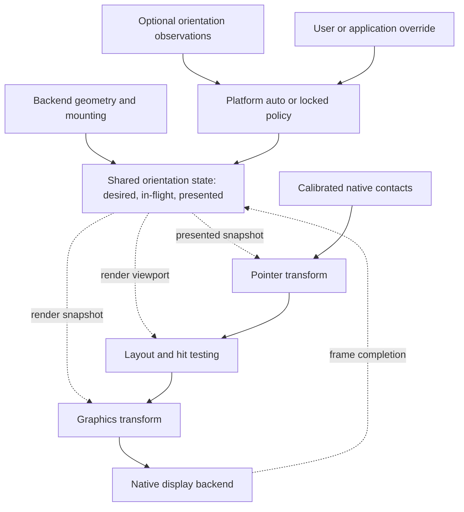

# Orientation state and coordinate spaces

[Platform overview](../platform.md)

The planned design has one shared orientation state for layout, graphics, and
pointer input. The backend supplies native dimensions, mounting information,
and optional orientation observations. Platform policy selects the logical
orientation. This state and policy stay planned work.
The current adapter supports one fixed turn.

Each coordinate space has a top-left origin.
The x coordinate increases to the right.
The y coordinate increases downward.

| Space | Meaning | What changes it |
| --- | --- | --- |
| Native panel | Backend framebuffer coordinates, with width `W` and height `H` | Fixed for the configured display |
| Device body | Coordinates relative to the enclosure's upright reference position | Fixed panel mounting maps native coordinates into this space |
| Logical UI | Coordinates for layout, rendering, and hit testing | Runtime orientation relative to the device body |

The platform will control an `OrientationState`.
The platform will supply geometry, mounting information, and orientation
observations. Graphics and input adapters will use snapshots of this state.
They will not select rotation independently.
The application will use the snapshot's logical viewport for layout and hit
testing. It will operate without the panel mounting angle or raw sensor samples.

The state has three parts:

- **Mounting transform:** fixed rotation from native panel coordinates to
  device-body coordinates. The backend supplies this transform.
  Touch calibration and sensor-axis alignment use separate fixed transforms.
  Each transform maps into its applicable reference space.
- **Logical orientation:** rotation from device-body coordinates to UI
  coordinates. Platform policy selects this rotation.
  `Auto` mode uses the sensor estimate.
  `Locked` mode selects an explicit orientation.
  An override replaces automatic selection.
  It does not add another rotation.
- **Effective transform:** composition of the mounting transform and logical
  orientation. The state includes the inverse, logical dimensions, and a
  revision that identifies the snapshot.
  For clockwise quarter-turns in these directions, the turn count is
  `(mounting + logical) mod 4`.
  Translations keep rotated pixel coordinates within bounds.

`M` maps the native panel to the device body.
`L` maps the device body to the logical UI.
Thus, the native-to-logical transform is `T = L ∘ M`.
Touch input uses `T`. Drawing uses `T⁻¹`.

Odd effective quarter-turns give an `H × W` viewport.
Even turns give a `W × H` viewport.
Native framebuffer dimensions and storage order stay the same when logical
orientation changes.

Solid arrows carry configuration, events, or drawing operations.
Dashed arrows supply an orientation snapshot or report frame completion.
Ordinary control events do not use the coordinate transform.

Orientation observations are policy inputs.
Input and graphics drivers do not change orientation policy.
Platform policy will apply stability thresholds before it selects a new
orientation. An ambiguous estimate will keep the last stable orientation.
The filter policy stays undecided.

A simulator orientation control will supply the same type of observation.
A manual lock will use the same override path as hardware.
A backend without an automatic orientation source reports that capability as
unavailable. Manual selection and orientation locks stay possible.
The application operates without the source's chip name or its physical or
synthetic origin.

## Orientation changes during display refresh

One mutable angle cannot represent all states of an asynchronous display refresh.
The state must have a **desired snapshot**, an **in-flight frame snapshot**, and a
**presented snapshot**. The in-flight snapshot identifies a submitted frame.
The presented snapshot identifies the last completed visible frame.
Layout and graphics use the same immutable snapshot for each render.
Touch must not use an orientation newer than the visible UI.

The planned transition has these steps:

1. Cancel an active gesture.
2. Block new gestures during the orientation change.
3. When the display is ready, compute layout from the latest desired snapshot.
4. Render a full frame with that snapshot.
5. Associate the snapshot with the submitted frame.
6. After successful completion, make that snapshot the presented snapshot.
7. When visible and desired orientations match and last contacts end, enable input again.

A rejected submission keeps the last presented snapshot.
Further orientation changes combine into the next frame.
A failure during physical driving can leave a partially changed image.
The platform marks presentation as unknown and blocks input until recovery
completes. The platform loop serializes these transitions.
Thus, layout, drawing, and input transforms cannot receive partial state changes.

## Implemented fixed orientation

The [device services](../device-interfaces.md#implemented-interfaces) specify the implemented contracts.
Native display targets use `OriginDimensions` with an origin of `(0, 0)`.
Their reported dimensions stay fixed for that target.
The platform crate has no fixed panel dimensions or application layout.

`PortraitDisplay` adapts a native target to a logical viewport.
`PortraitRotation` uses the same transform for touch coordinates.
The backend selects native dimensions.
The [application layout](../application.md#layout-and-input) defines its required logical viewport.
Other applications can use different dimensions without a change to these adapters.

`PortraitRotation` implements one effective clockwise quarter-turn.
It has no separate mounting transform, policy, or runtime state.
For native height `H`, it maps native `(x, y)` to logical `(H - 1 - y, x)`.
It maps logical `(x, y)` to native `(y, H - 1 - x)`.
These mappings exercise pixel and touch transforms.
They do not identify the actual panel mounting angle.

`PortraitDisplay` writes directly into the native target.
It allocates no second framebuffer.
It clips pixels outside portrait bounds before transformation.
Clipping keeps positions in contiguous color streams.
A clear operation passes to the native display.
Refresh calls, busy state, and errors pass through unchanged.

Touch drivers first produce pixel coordinates aligned with the native panel.
They then use `PortraitRotation::touch_to_portrait`.
Drivers control raw coordinate ranges and axis conventions.
Invalid coordinates produce `Cancel`, which cancels an armed gesture.
Runtime orientation changes stay outside the current interface.

The simulator uses both fixed-orientation paths.
It renders through `PortraitDisplay` into native storage.
It converts browser contact positions into native input before the shared touch
rotation. PNG export rotates the completed native image into the portrait view.
The temporary export buffer belongs to the simulator.
The application does not draw into that buffer.

## Planned simulator behavior

With runtime orientation, simulator device pose must stay independent of the
logical UI override. Enclosure rotation changes the device presentation.
An orientation lock changes content within that enclosure.
Frame export must use the state associated with that frame.
It must not use the latest desired orientation.

## Planned validation

Planned orientation scenarios include overrides and rotation during a touch or display refresh.
They also include combined changes and failed submissions.
The visible layout and touch coordinates must agree in all cases.
